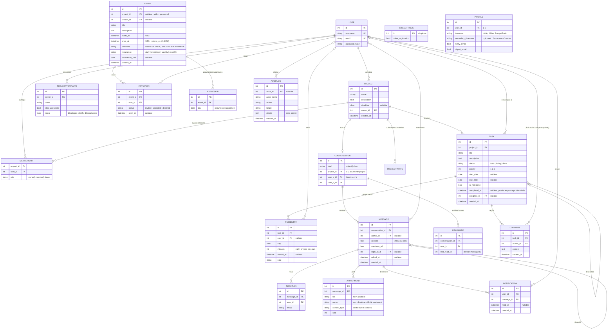
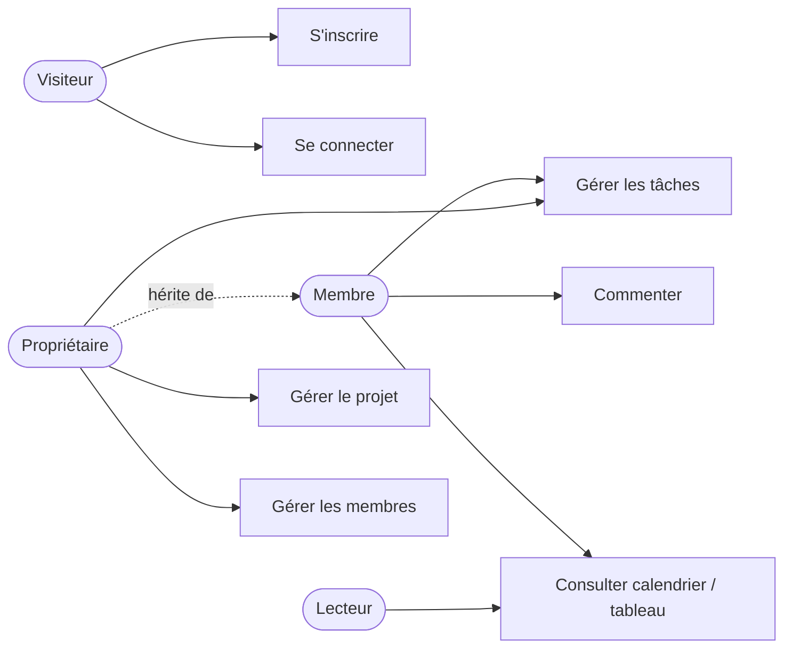
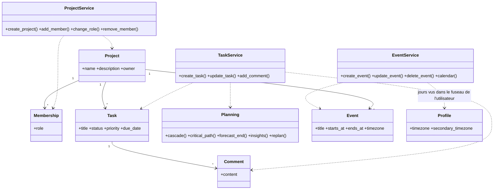
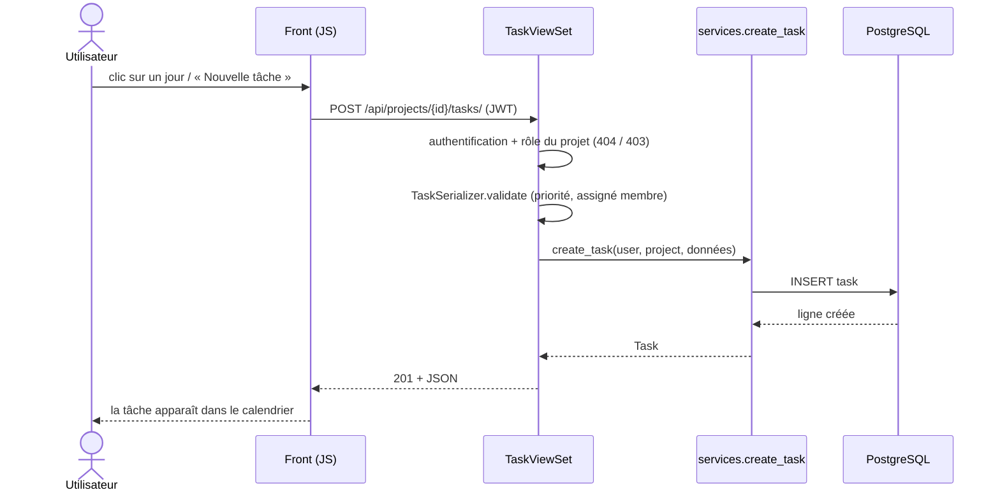
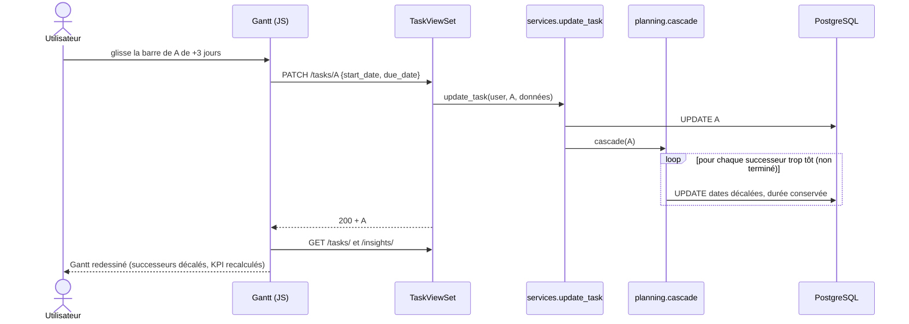
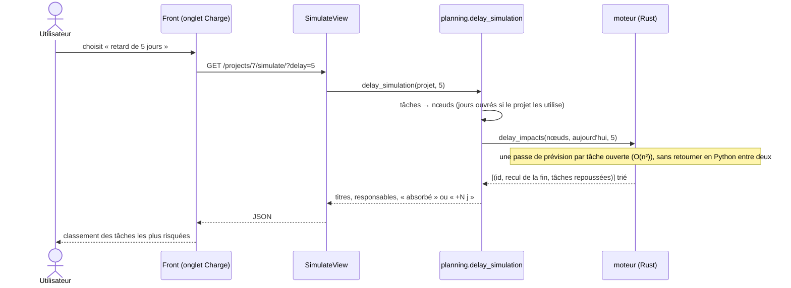

# Modèle de données et diagrammes UML

Les diagrammes sont en Mermaid (rendus automatiquement par GitHub).

## MCD / MLD

Contraintes : `TIMEENTRY` : durée ≤ 24 h et soit `minutes` soit `started_at` renseigné (CHECK) ; `INVITATION (event_id, user_id)` unique ; `REACTION (message, user, emoji)` unique ; `MEMBERSHIP (project_id, user_id)` unique ; `TASK.start_date <= due_date` (CHECK) ; table de liaison `task_dependencies` (auto-association N:N, boucles interdites côté service) ; `TASK.priority` entre 1 et 3 (CHECK) ; suppression d'un projet → cascade sur membres, tâches, commentaires ; retrait d'un membre → ses tâches redeviennent non assignées.

Implémentation : `backend/projects/models.py`, `backend/tasks/models.py`, migrations associées.

## Cas d'utilisation


## Diagramme de classes (couche métier)


## Séquence : créer une tâche


## Séquence : déplacer une barre du Gantt (propagation des dépendances)


## Séquence : créer un événement saisi dans un autre fuseau
```mermaid
sequenceDiagram
    actor U as Utilisateur (calendrier en heure de Paris)
    participant F as Front
    participant V as EventViewSet
    participant S as EventSerializer
    participant E as agenda.services
    participant DB as Base (UTC)
    U->>F: « 11 h » le mercredi, fuseau Montréal
    F->>V: POST /events/ {starts_at: "2026-10-07T11:00", timezone: "America/Montreal"}
    V->>S: validation
    S->>S: heure sans décalage = heure murale de Montréal → 2026-10-07T15:00:00Z
    V->>E: create_event(user, …)
    E->>E: droits (propriétaire/membre du projet), fin > début, durée ≤ 31 j
    E->>DB: INSERT (starts_at en UTC)
    V-->>F: 201
    F->>V: GET /calendar/?from=…&to=…
    V-->>F: événements + tâches ; le front affiche 17:00 (heure de Paris)
```

## Séquence : mentionner un collègue
```mermaid
sequenceDiagram
    actor A as Alice
    participant F as Front (chat.js)
    participant V as MessagesView
    participant S as chat.services
    participant DB as Base
    actor B as Bob
    A->>F: tape « @b » → liste (bob), Entrée → « @bob »
    A->>F: Entrée (envoi)
    F->>V: POST /chat/conversations/10/messages/ {content}
    V->>S: post_message(alice, conv, content)
    S->>S: droits (écriture), 1..2000 caractères
    S->>S: parse_mentions : seuls les participants (bob), jamais l'auteur ; @tous = tous les autres
    S->>DB: INSERT message + mentions + notifications (bob)
    V-->>F: 201 message
    loop toutes les 15 s
        B->>F: (navigateur de Bob) GET /chat/summary/
        F-->>B: pastille 🔔 « 1 » + message « Vous avez été mentionné »
    end
    B->>F: clic sur la notification
    F->>V: POST /notifications/ {ids:[…]} puis GET messages
    V->>S: marquer lue ; ouvrir le fil (marque le fil comme lu)
```

## Séquence : simulation « et si cette tâche prenait du retard ? »


## Liens d'invitation (`ProjectInvite`)
`project`, `token_hash` (SHA-256 du jeton, unique : **le jeton lui-même n'est jamais stocké**, comme un mot de passe), `role` (membre ou lecteur, jamais propriétaire), `created_by` (nullable), `created_at`, `expires_at`, `max_uses`, `uses`, `revoked`. Un lien est valable tant qu'il n'est ni révoqué, ni expiré, ni épuisé ; l'acceptation verrouille la ligne (`select_for_update`) pour que deux personnes simultanées ne dépassent pas `max_uses`.
