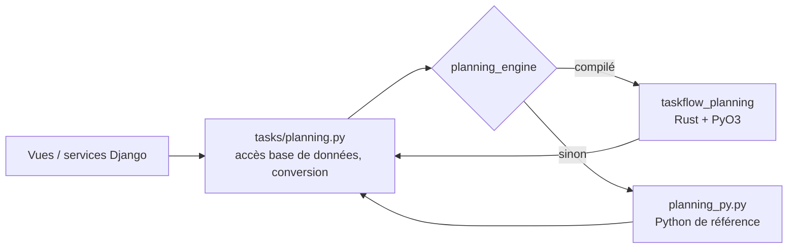

# Module Rust — moteur de planification

## Rôle
Les calculs de planification (chemin critique, décalage en cascade des dépendances, fin prévue) sont des algorithmes de graphes purs. Ils sont implémentés **deux fois** avec le même contrat :

| | Fichier | Rôle |
|---|---|---|
| Rust | `backend/planning_rs/src/engine.rs` (+ `lib.rs` pour la liaison PyO3) | moteur utilisé quand il est compilé |
| Python | `backend/tasks/planning_py.py` | implémentation de **référence** et solution de repli |

Le choix est fait au démarrage par `tasks/planning_engine.py` :
`TASKFLOW_PLANNING_BACKEND=auto` (défaut : Rust s'il est installé), `rust` (erreur au démarrage s'il manque) ou `python`. Le moteur actif est visible dans `GET /health/` et dans l'administration (Vue d'ensemble → État du système).



`planning.py` reste la seule couche qui connaît Django : elle convertit les tâches en nœuds `(id, terminée, début, fin, prérequis)` (dates en ordinaux), appelle le moteur, puis écrit le résultat. Le moteur ne touche jamais à la base.

## Contrat
| Fonction | Entrée | Sortie |
|---|---|---|
| `critical_path(nodes)` | nœuds | `(ids triés par début au plus tôt puis id, durée totale)` ; `ValueError("cycle")` |
| `forecast_end(nodes, today)` | nœuds, ordinal du jour | ordinal de la fin prévue ou `None` ; `ValueError("cycle")` |
| `cascade_shifts(nodes, changed_id)` | nœuds, tâche modifiée | `[(id, début, fin)]` des tâches repoussées, triées par id |

Règles : on ne repousse jamais une tâche plus tôt ; les tâches terminées ne bougent pas et arrêtent la propagation ; une durée nulle vaut 1 jour ; un cycle est signalé, jamais bouclé (garde-fou sur le nombre d'itérations).

## Garantir que les deux versions restent identiques
- `cargo test --lib` : 7 tests Rust (cascade, chemin critique, prévision, cycles).
- `tasks/test_engine.py` : compare Rust et Python sur environ **1 200 graphes aléatoires** (DAG, graphes avec cycles, tâches terminées ou non planifiées, graphe de 3 000 tâches). Une divergence fait échouer le test.
- Toute la suite Django (158 tests) est exécutée **avec chaque moteur** (matrice `engine: [rust, python]` en CI).

Règle d'or : modifier un algorithme = modifier **les deux** fichiers + ajouter le cas au test de comparaison.

## Mesures (`python bench_planning.py`, Mac Intel, Python 3.12, Rust 1.99 `--release`)
| Tâches | Fonction | Python | Rust | Gain |
|---|---|---|---|---|
| 50 | chemin critique | 0,15 ms | 0,03 ms | ×5 |
| 1 000 | chemin critique | 2,98 ms | 0,60 ms | ×5 |
| 20 000 | chemin critique | 70,7 ms | 12,9 ms | ×5 |
| 20 000 | fin prévue | 40,8 ms | 10,1 ms | ×4 |
| 20 000 | cascade | 13,1 ms | 8,3 ms | ×2 |

**Lecture honnête** : le gain est réel mais modeste (×2 à ×5). Environ 8 à 10 ms sur 12 ms (20 000 tâches) sont consommées par la **copie des données de Python vers Rust**, pas par le calcul. Un projet réaliste (quelques dizaines de tâches) se calcule en moins d'une demi-milliseconde dans les deux cas : **l'utilisateur ne perçoit aucune différence**. L'intérêt du module est surtout architectural (frontière FFI propre, contrat testé, repli automatique) et ouvre la voie à des calculs plus lourds (simulation de scénarios, nivellement des ressources) où le gain deviendrait sensible. Une première version du moteur (tables de hachage) ne donnait que ×1 à ×3 : le passage à des tableaux indexés a été guidé par ces mesures.

## Compiler et installer
```bash
# 1. Rust (une fois) : https://rustup.rs  — installé dans ~/.cargo
curl --proto '=https' --tlsv1.2 -sSf https://sh.rustup.rs | sh
# 2. Dans le dépôt
cd backend
pip install maturin                       # (dans le venv)
export PYO3_PYTHON="$PWD/.venv/bin/python"   # cargo doit voir le Python du projet, pas celui du système
(cd planning_rs && cargo test --lib)      # tests Rust
maturin develop --release --uv -m planning_rs/Cargo.toml   # compile et installe dans le venv
python manage.py test tasks.test_engine   # comparaison Rust / Python
python bench_planning.py                  # mesures (nécessite DJANGO_SETTINGS_MODULE)
```
`--uv` est requis quand le venv est créé avec `uv` (pas de `pip` dedans). Le module est une roue **abi3** (Python ≥ 3.10) : une seule compilation suffit pour toutes les versions.

## Sécurité et robustesse
- Aucun `unsafe` dans le code du projet ; la mémoire est gérée par Rust, PyO3 contient la frontière avec Python.
- Entrées non fiables : les identifiants et dates viennent de la base, jamais directement de l'utilisateur. Un graphe incohérent (boucle) renvoie une erreur au lieu de boucler ou de planter.
- Chaîne d'approvisionnement : `Cargo.lock` est versionné (versions exactes des dépendances) ; une seule dépendance directe (`pyo3`). À ajouter en production : `cargo audit` en CI.
