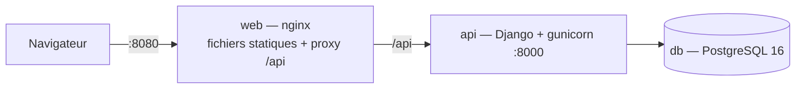

# Déploiement

## Architecture


## Lancer
```bash
cp .env.example .env     # puis ajuster les secrets
docker compose up --build
```
L'image `api` applique les migrations au démarrage. Volumes : `pgdata` (base) et `media` (pièces jointes de la messagerie) — **tous deux à sauvegarder**.

## Développement local
`./start.sh` lance l'API (port 8000) et le front (port 5173, `frontend/serve.py` : aucun cache navigateur) puis ouvre le navigateur ; `./start.sh stop` arrête tout. Journaux dans `.logs/`.

## Variables d'environnement
| Variable | Rôle | Production |
|---|---|---|
| `DJANGO_SECRET_KEY` | clé de signature | valeur aléatoire longue (≥ 32 caractères) |
| `DJANGO_DEBUG` | mode debug | `0` |
| `DJANGO_ALLOWED_HOSTS` | hôtes autorisés | votre domaine |
| `CORS_ALLOWED_ORIGINS` | origines autorisées si front sur un autre domaine | à définir |
| `POSTGRES_*` | connexion base | mots de passe forts |
| `DATABASE_URL` | adresse unique de connexion PostgreSQL (prioritaire sur `POSTGRES_*`) ; fournie par Railway | `${{Postgres.DATABASE_URL}}` |
| `SITE_URL` | adresse publique du front (liens des e-mails) | `https://taskflow.exemple.fr` |
| `EMAIL_BACKEND`, `EMAIL_HOST`, `EMAIL_PORT`, `EMAIL_USE_TLS`, `EMAIL_HOST_USER`, `EMAIL_HOST_PASSWORD`, `DEFAULT_FROM_EMAIL` | envoi des e-mails (mentions, invitations, résumé) ; par défaut ils s'affichent dans la console | SMTP du fournisseur, identifiants dans un gestionnaire de secrets |
| `MEDIA_ROOT` | dossier des pièces jointes (volume `media` dans Docker) | volume persistant **sauvegardé** |
| `LOGIN_RATE`, `REGISTER_RATE`, `CHAT_RATE`, `ACCOUNT_RATE` | limites de débit (`10/min`, `10/hour`, `60/min`, `10/hour`) | à ajuster selon le trafic |
| `NUM_PROXIES` | nombre de proxys devant l'API (pour lire la vraie adresse IP des clients) | `1` derrière nginx |

## Railway
Trois éléments dans un même projet Railway : la base, l'API et le front. Railway n'exécute pas `docker-compose.yml` : chaque service se construit à partir de son Dockerfile (`backend/railway.json`, `frontend/railway.json`).

1. **Base** : *New → Database → PostgreSQL*.
2. **Service `api`** : *New → GitHub Repo*, **Root Directory** = `backend`. Nommer le service `api`. Ajouter un **Volume** monté sur `/data/media` (pièces jointes). Variables :
   - `DATABASE_URL` = `${{Postgres.DATABASE_URL}}`
   - `DJANGO_SECRET_KEY` = valeur aléatoire (`python -c "import secrets;print(secrets.token_urlsafe(50))"`)
   - `DJANGO_DEBUG` = `0`
   - `DJANGO_ALLOWED_HOSTS` = `<domaine-du-front>,api.railway.internal,healthcheck.railway.app`
   - `MEDIA_ROOT` = `/data/media`
   - `NUM_PROXIES` = `2` (le proxy de Railway puis nginx)
   - `SITE_URL` = `https://<domaine-du-front>` ; SMTP si on veut de vrais e-mails.
   - **Ne pas** générer de domaine public pour ce service : seul le front est exposé.
3. **Service `web`** : *New → GitHub Repo*, **Root Directory** = `frontend`, puis *Settings → Networking → Generate Domain*. Variable : `API_UPSTREAM` = `api.railway.internal:8000`. (`PORT` est fourni par Railway.)
4. **Premier administrateur** : `railway run --service api python manage.py createsuperuser` (ou inscription puis passage en `is_staff` ; fermer ensuite l'inscription dans l'administration si besoin).
5. **Résumé du matin** : un service *Cron* Railway avec `python manage.py send_digest`.

Points de vigilance : un seul worker gunicorn (+ 8 fils) pour que les limites de débit, stockées en mémoire, restent communes ; sauvegarder la base (`pg_dump`) et le volume ; la configuration n'a pas encore été exécutée sur Railway ni avec Docker (non installé sur la machine de développement).

## Image de l'API
`backend/Dockerfile` : étape 1 compile le module Rust (rustup + maturin, roue abi3, `cargo test` inclus), étape 2 installe la roue dans une image Python sans compilateur. Si le module est absent, l'application tourne avec la version Python (visible dans `/health/` → `planning_engine`).

## Tâches planifiées
Le résumé du matin n'est envoyé que si on le planifie (aucun processus en arrière-plan n'est démarré par l'application) : `0 7 * * 1-5  cd /app && python manage.py send_digest` (cron de l'hôte, ou `docker compose exec api python manage.py send_digest`). `--dry-run` affiche les résumés sans rien envoyer.

## Application installable (PWA)
Le front fournit un manifeste, des icônes et un service worker (`frontend/sw.js`, « réseau d'abord ») : le navigateur propose d'installer l'application. Cela exige **HTTPS** (sauf localhost) ; le service worker n'est enregistré qu'hors localhost. Les requêtes `/api/` ne sont jamais mises en cache.

## Intégration continue
`.github/workflows/ci.yml` : sur chaque push, démarre PostgreSQL, installe les dépendances, vérifie qu'aucune migration n'est oubliée, lance les tests — en **matrice** : une fois avec le moteur Rust (tests Rust + compilation), une fois avec le moteur Python. Un second job **e2e** lance les 33 scénarios de bout en bout dans Firefox headless (`./test-e2e.sh`).

## À faire
Passer `gunicorn` derrière HTTPS (reverse proxy), sauvegarde planifiée de la base (`pg_dump`), build et publication des images dans la CI.
