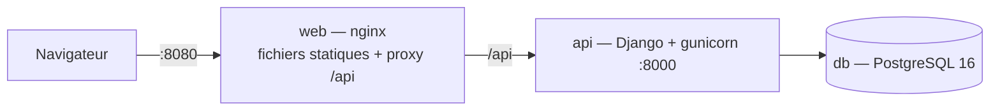

# Déploiement

## Architecture


## Lancer
```bash
cp .env.example .env     # puis ajuster les secrets
docker compose up --build
```
L'image `api` applique les migrations au démarrage. Volume `pgdata` pour la persistance.

## Développement local
`./start.sh` lance l'API (port 8000) et le front (port 5173, `frontend/serve.py` : aucun cache navigateur) puis ouvre le navigateur ; `./start.sh stop` arrête tout. Journaux dans `.logs/`.

## Variables d'environnement
| Variable | Rôle | Production |
|---|---|---|
| `DJANGO_SECRET_KEY` | clé de signature | valeur aléatoire longue (≥ 32 caractères) |
| `DJANGO_DEBUG` | mode debug | `0` |
| `DJANGO_ALLOWED_HOSTS` | hôtes autorisés | votre domaine |
| `CORS_ALLOWED_ORIGINS` | origines autorisées si front sur un autre domaine | à définir |
| `POSTGRES_*` | connexion base | mots de passe forts |

## Image de l'API
`backend/Dockerfile` : étape 1 compile le module Rust (rustup + maturin, roue abi3, `cargo test` inclus), étape 2 installe la roue dans une image Python sans compilateur. Si le module est absent, l'application tourne avec la version Python (visible dans `/health/` → `planning_engine`).

## Intégration continue
`.github/workflows/ci.yml` : sur chaque push, démarre PostgreSQL, installe les dépendances, vérifie qu'aucune migration n'est oubliée, lance les tests — en **matrice** : une fois avec le moteur Rust (tests Rust + compilation), une fois avec le moteur Python.

## À faire
Passer `gunicorn` derrière HTTPS (reverse proxy), sauvegarde planifiée de la base (`pg_dump`), build et publication des images dans la CI.
